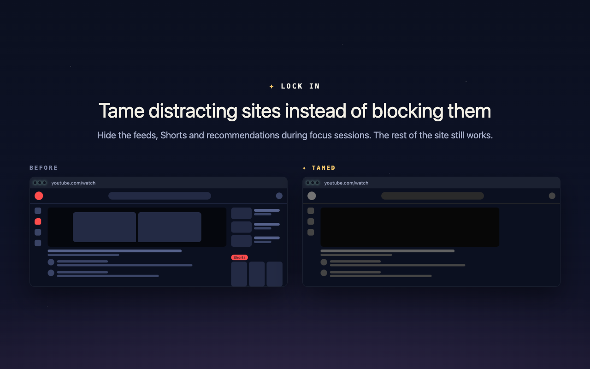

# ✦ Lock In

A free, open-source focus app. Social media is light pollution: when you lock in, the noise fades and you can finally see the stars.



> **Status:** 0.1.0, the first release. The desktop app for macOS and Linux is on [Releases](https://github.com/lock-in-focus-app/lock-in/releases/latest), and the browser extension is in review at the Chrome Web Store and Firefox Add-ons. See [PLAN.md](PLAN.md) for the roadmap.

## Tame, don't just block

Most blockers treat a site as all or nothing. Lock In gives every site one of four levels, chosen per session profile:

| Level | What happens |
|---|---|
| **Allowed** | Nothing changes. |
| **Tamed** | The site still works, but the distracting parts are hidden: feeds, trending, suggested and promoted posts. Optionally grayscale. |
| **Redirected** | Visits go to a calm Lock In page first: focus for five minutes, read your if-then plan, or open one of your own links. If you still need the site once the wait is up, take a few minutes on it. |
| **Restricted** | Blocked, with no way through until the session ends. |

**Page rules** give part of a site its own level, like redirecting YouTube Shorts while the rest of YouTube is tamed, or allowing `reddit.com/r/writing` while the rest of Reddit is redirected.

What "tamed" means for a site is a **recipe**: a small JSON file of toggles, each mapped to CSS selectors. There are built-in recipes for Reddit, YouTube, X, Instagram, TikTok, Facebook, LinkedIn, Pinterest, Twitch, Threads and Bluesky, and any other site can be added by its address. You can flip toggles from the extension popup for one session or save them to a profile, click away any other part of a page with **Hide parts of this page**, and keep a site tamed all the time, outside sessions too.

## The desktop app

The extension works on its own. The desktop app adds:

- **A night sky that fills with your focus.** Each session becomes a star in your profile's color, each week's stars form a constellation you name, and each month with focus grows a planet. Comets, meteor showers and auroras turn up now and then.
- **Satellites:** a distracting thought goes into orbit with Alt+P (Option+P on a Mac) from anywhere, and comes back when the session ends.
- **Apps too:** a profile can close or hide apps like Discord, Steam or Slack during its sessions.
- **Strictness:** Gentle sessions can end any time, Medium ones ask you to type a random string first, and Hard ones last until the timer runs out, with a few emergency passes a week.
- **A quiet timer** that can end without a sound, and sessions that end by themselves when you've walked away.
- **A weekly report**, and backups you can bring to another computer.
- **Blocking without the extension** (macOS, turned on in Settings): restricted sites are shut for every browser and app during a session.

Lock In has no accounts and no telemetry. Everything stays on your device. See [PRIVACY.md](PRIVACY.md).

## Install

- **Desktop app:** download it from the [latest release](https://github.com/lock-in-focus-app/lock-in/releases/latest): a `.dmg` for macOS, or a `.deb` or `.AppImage` for Linux. On macOS, it isn't signed with a paid Apple Developer account, so macOS asks you to allow it once: open it, click **Done**, then **System Settings › Privacy & Security › Open Anyway**. The release notes walk through it.
- **Browser extension:** in review at the Chrome Web Store and Firefox Add-ons. Until it's listed, build it from source (below).

The app and the extension each work on their own. Install both and they link up by themselves.

## What's here

```
apps/
  extension/   Browser extension (WXT + Vue). Chrome, Brave, Edge, Arc, Firefox, Zen.
  desktop/     Desktop app (Tauri 2 + Vue). macOS and Linux.
  website/     Product website (Nuxt). Scaffolded.
packages/
  core/        Shared types and logic: matching, recipes, profiles, sessions.
  recipes/     Built-in site recipes.
  quotes/      Bundled public-domain quotes for the app's Sky.
```

## Getting started

You'll need Node 22 or newer and pnpm (`corepack enable` sets it up).

```bash
pnpm install
pnpm dev:extension
```

`pnpm dev:extension` opens a browser with the extension loaded and reloads it as you edit. Use `pnpm dev:extension:firefox` for Firefox. To load a build by hand instead, see [apps/extension/README.md](apps/extension/README.md). The store listings' text, zips and screenshots are in [apps/extension/STORE.md](apps/extension/STORE.md).

Other useful commands:

```bash
pnpm test          # unit tests
pnpm test:e2e      # browser tests for the extension (see apps/extension/README.md)
pnpm typecheck
pnpm lint          # ESLint
pnpm format        # Prettier (pnpm format:check only reports)
pnpm build
```

The desktop app also needs the [Rust toolchain](https://rustup.rs) and the [Tauri prerequisites](https://v2.tauri.app/start/prerequisites/). Run it with `pnpm dev:desktop`.

To release, raise the version in `apps/desktop/src-tauri/tauri.conf.json`, `Cargo.toml` and both apps' `package.json`, then push a matching tag like `v0.2.0`. That builds the macOS and Linux apps onto a draft release ([`.github/workflows/release.yml`](.github/workflows/release.yml)), which is published by hand.

## Contributing

Recipes break when sites change their HTML, so fixes to the selectors in `packages/recipes` are especially welcome. Each recipe is plain JSON, and `pnpm test` checks that every selector is safe to inject.

Before opening a pull request, run `pnpm format`, `pnpm lint` and `pnpm test`; CI checks all three.

## License

[AGPL-3.0](LICENSE). You're free to use, study, change and share Lock In. If you run a modified version for other people, including as a hosted service, you must share your changes under the same license.
